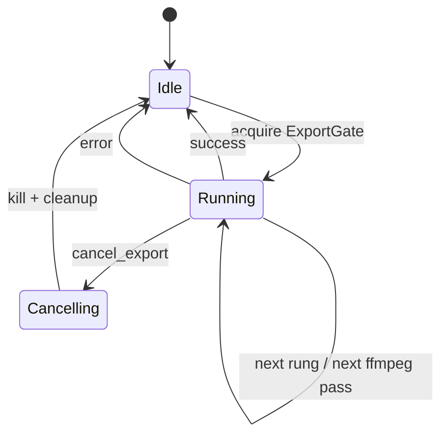
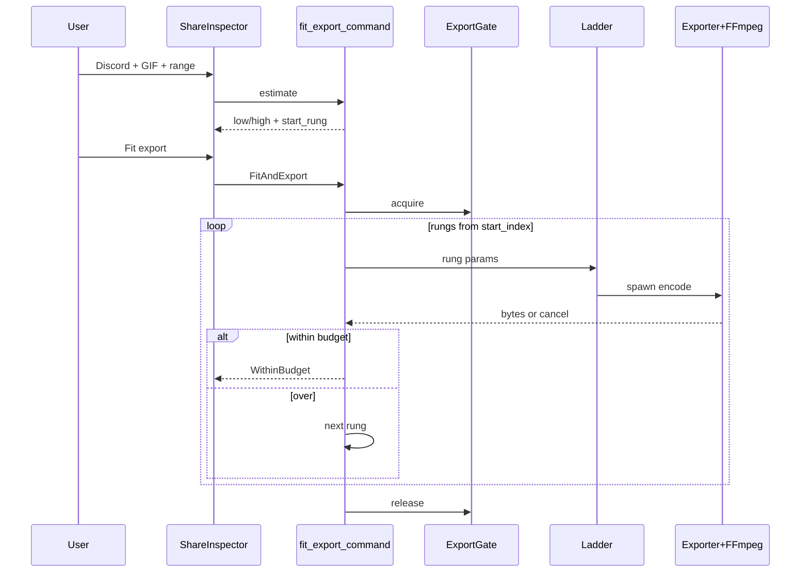
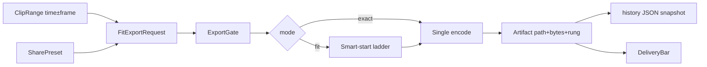
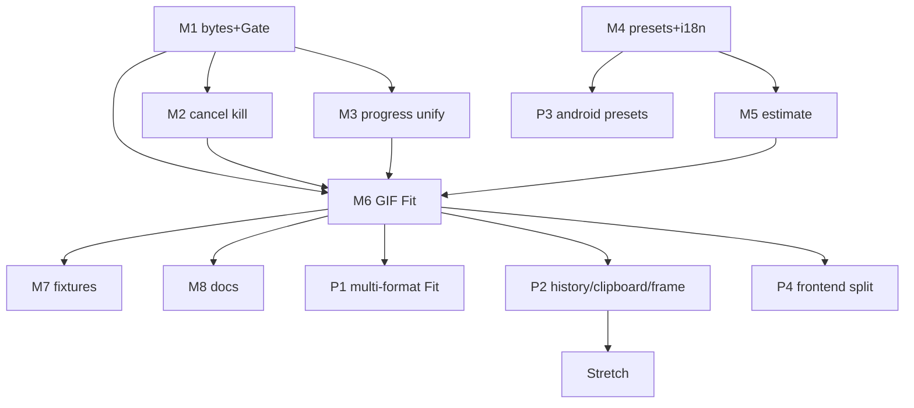

# QuickGif 产品重设计与技术架构方案

| 字段 | 内容 |
|------|------|
| **文档标题** | QuickGif：Frame-Perfect Share Studio 产品重设计 |
| **作者** | TBD |
| **日期** | 2026-07-13 |
| **状态** | Draft r3（修订 3：补 best_so_far、ExactExportParams、Gate 接线、path-copy 非门禁） |
| **关联仓库** | `/Users/wangxuwen/Documents/QuickGif` |
| **版本目标** | 从「能用的剪辑导出器」升级为「有明确叙事与不可替代工作流的本地分享工作室」 |
| **MVP 切割线** | **当 Discord GIF Fit 端到端可用（预设 → 阶梯导出 → 显示 bytes/rung → 可取消）即可对外演示/软发布**；不要求 16 个 PR 全部落地 |

---

## Overview

QuickGif 当前是一个技术扎实、体验尚可的本地视频片段工具：Tauri 2 + React + 内置 FFmpeg，具备双时间轴、帧时间戳索引、快捷键与 MP4/WebP/GIF/PNG 导出。它**工程上完整，但产品上同质化**——用户没有理由在 Gifski、Kap、ScreenToGif、在线 GIF 站、CapCut 片段导出之间优先选择它。

本方案将产品重新定位为：

> **面向技术沟通者的本地「帧级精确 · 体积可控 · 即发即用」分享工作室（Frame-Perfect Share Studio）。**

核心叙事不是「又一个 GIF 制作器」，而是：**你已经有录屏 / 演示 / 回放视频；QuickGif 负责在本地、用键盘、精确裁切，并导出刚好能发到 Discord / Slack / 微信 / Twitter / GitHub 的成品，在体积预算内尽量好看。**

**诚实边界（相对初稿）：**

- **Fit-to-Share 的「哇」感主要落在 GIF / 动画 WebP**。短 MP4 很少顶满 8MB；MP4 阶梯是完整叙事的一部分，但 **MVP 以 GIF Fit 为门禁**。  
- **今日桌面并非真正「逐帧」**：左右键实际是 ±5 秒 seek（`SEEK_STEP_SECONDS = 5`）；I/O 只写 `startTime`/`endTime`；导出用输入侧 `-ss`（关键帧快速 seek）。「Frame-Perfect」是**要建成的工作台目标**，不是对现状的描述。  
- **桌面没有导出质量 Inspector 控件**：GIF 的 `w720`/`fps15`/`standard` 在 `exportClip` 中硬编码；Android 已有 width/fps/quality chips。

围绕叙事定义 **3 个 Hero 能力**（按优先级）：

1. **Fit-to-Share（体积预算阶梯）** — 平台预设 + 自动质量阶梯；导出保证 ≤ 目标体积或明确 OverBudget。  
2. **Frame-Perfect Workbench（帧级工作台）** — 修正/强化：真逐帧、帧号标记、帧准确导出模式。  
3. **Instant Delivery（即发闭环）** — 导出后 bytes 可见；macOS 剪贴板文件引用优先；历史快照支持重 Fit。

---

## Background & Motivation

### 当前状态（代码事实）

| 层 | 现状 | 关键路径 |
|----|------|----------|
| 桌面前端 | 单体 `App.tsx`（~1580 行）+ `App.css` + `trackpadInteraction.ts`；文案内嵌 `translations` | `src/` |
| 桌面后端 | 探针 / 缩略图 / 帧索引 / 四路导出 / 设置 / FFmpeg 定位 | `src-tauri/src/*.rs` |
| Tauri 命令 | `probe`、`generate_thumbnails`、`generate_detail_thumbnails`、`build_frame_index`、`export_{gif,mp4,webp,frame_image}`、settings | `src-tauri/src/lib.rs` |
| GIF 导出 | 已有 `ExportWidth` / `ExportFrameRate` / `ExportQuality` + palettegen/paletteuse；`-ss`/`-to` **在 `-i` 之前** | `gif_exporter.rs` |
| MP4/WebP | MP4 仅 `start/end`，固定 `-crf 20`、even scale；WebP 硬编码约 `fps=15`、`scale=720:720:...`；同样输入侧 `-ss` | `mp4_exporter.rs`, `webp_exporter.rs` |
| 前端导出 | GIF 参数**硬编码** `w720` / `fps15` / `standard`；**桌面 UI 无** width/fps/quality 控件（不是「有控件未接线」） | `App.tsx` `exportClip` |
| 导航语义 | 快捷键名 `previousFrame`/`nextFrame`，实现为 `± SEEK_STEP_SECONDS`（5s）；文案亦为「后退/前进 5 秒」 | `App.tsx` |
| 帧索引 | `FramePoint[]` 用于 UI 邻近定位；`nearest_frame` 仅 `#[cfg(test)]`，导出路径未用 | `frame_indexer.rs` |
| 配置目录 | `app.path().app_config_dir()` + `settings.json`（identifier `com.quickgif.desktop`） | `settings.rs` |
| UI | Graphite liquid glass：预览 + 双时间轴 + 状态/结果区（无独立 quality inspector） | `App.css`, `design-qa.md` |
| Android | Kotlin/Compose MVP：width/fps/quality chips + `Intent.ACTION_SEND`；**无**平台预设/体积阶梯 | `android/` |
| 进度事件 | 三套：`gif-export-progress` / `mp4-export-progress` / `webp-export-progress`，stage 中英文混用 | 各 exporter |
| 取消 | **无** cancel 命令、无 `Child` 句柄、无 kill 路径 | 各 exporter |

**已有差异化资产（应放大，并诚实标注成熟度）：**

| 资产 | 现状成熟度 | 放大方向 |
|------|------------|----------|
| 双时间轴 overview + detail + trackpad | **已可用** | 保持；接范围芯片 / 建议点 |
| ffprobe 帧时间戳索引 | **UI scrub 可用**；导出/逐帧未用满 | 真逐帧 step；导出 FrameAccurate 模式 |
| 本地隐私 + 随包 FFmpeg | **已可用** | Fit ladder / overlay（bundled 已 `--enable-libfreetype`） |
| 键盘 I/O / Space / ⌘E | **已可用** | 修正 Left/Right 为帧步进（index 就绪时） |
| 多格式出口 | **已可用** | 参数化 + Fit；GIF 为主 wow 路径 |
| Android 手动质量 chips + 分享 | **部分可用** | 预设映射 + 实体积 toast；**不做**设备上多档试导出 |

### 痛点

1. **没有产品 thesis**：功能清单正确，但「为什么选我」为空。  
2. **导出决策未产品化**：后端 GIF 旋钮已存在，**桌面完全没有质量 UI**（参数硬编码）；用户不知能否塞进 Discord/微信。  
3. **工作流断在导出后**：有路径提示，但无剪贴板、无历史、无重导出。  
4. **「帧」叙事名不副实**：索引在、导出与左右键未对齐帧语义。  
5. **架构阻碍迭代**：`App.tsx` 单体 + 内嵌 i18n；导出器参数模型不统一；无 job/cancel。  
6. **Android 与桌面叙事分裂**：像两个产品。

### 竞争格局（简述）

| 竞品 | 强项 | QuickGif 可攻击的弱点 |
|------|------|----------------------|
| Gifski | macOS 高质量 GIF、拖放简单 | 弱时间轴/弱跨平台/无平台体积预算自动阶梯 |
| Kap | 录屏 + 若干导出预设 | 偏录屏；长视频帧级 scrub 弱；非「已有视频 → 适配聊天上限」 |
| ScreenToGif | Windows 强、可编辑帧 | 偏重、跨平台差、中文/微信场景弱 |
| CapCut | 全能剪辑 | 重、云/账号、非「30 秒切一段发聊天」 |
| 聊天客户端自带压缩 | 发送时压缩 | 不可控、画质差、无预览策略、无本地精确裁切 |
| 在线 GIF 站 | 零安装 | 隐私差、上传慢、精度差、体积不可控 |
| QuickTime Trim | 系统自带 | 几乎无 GIF/WebP、无平台预设 |
| 通用 FFmpeg GUI | 灵活 | 无产品化预设/阶梯/键盘工作台 |

---

## Goals & Non-Goals

### Goals

1. **清晰定位**：技术沟通场景下的「最后一公里」本地导出工具。  
2. **可演示 Hero**：优先 **GIF Fit-to-Share 垂直切片**；再 Frame workbench 与 Delivery。  
3. **在现有栈上增量演进**：Tauri + 本地 FFmpeg；无云端模型主路径。  
4. **导出结果可预期**：导出前预估区间；导出中可取消；导出后真实 bytes + rung + 是否达标。  
5. **代码可演进**：先垂直切片，再拆分前端；统一导出 job / progress / 请求模型。  
6. **Android 叙事对齐**：预设名 + 单次 encode 参数映射 + 体积提示；非桌面能力全集。

### Non-Goals（明确不做）

- 全功能 NLE（多轨、转场、调色、音频混音、字幕时间轴编辑器）。  
- 以云端 LLM/生成式视频为主卖点的「AI 做片」。  
- 替代 OBS/系统录屏成为录屏工具。  
- 账号体系、云同步、协作评论。  
- 短期内用 Tauri Mobile 重写 Android。  
- 批量渲染农场、插件市场、主题商店。  
- **Android / 移动端多档 trial encode ladder**（耗电、散热、磁盘；见 Android 节）。  
- **v1 用 asset protocol 预览任意历史导出路径**（安全策略见 Security）。  
- 自动静默裁剪用户所选时长以塞进预算（默认关闭；见 Key Decisions）。

---

## Product Thesis（产品主张）

### 一句话

**QuickGif：把本地视频切成「帧准、体可控、即刻可发」的分享素材。**

### 目标用户（Primary）

1. **工程师 / 技术支持**：bug 复现、终端操作 → GIF/WebP 贴 Issue、Slack、Discord。  
2. **产品 / 设计 / 增长**：演示交互 → 微信群 / Twitter。  
3. **内容轻量创作者**：从长录屏抠 3–15 秒可发素材。

### Job-to-be-Done

> 当我有一段本地视频时，我要**精确**选中起止范围，并在 **N MB 客户端预算内**得到可直接粘贴/拖入聊天工具的文件，全程**不上传云端**。

### 成功标准（产品）

| 指标 | 目标 | 测量方式 |
|------|------|----------|
| 首次成功导出可发文件 | < 60s 完成「导入 → 打点 → Fit Discord → 见结果」 | 可用性走查 |
| 体积达标率 | 在 **fixture 集**上 Fit GIF ≥ 95% within budget，或明确 `OverBudget` + 次优文件 | 自动化 + 固定样本（见 Testing） |
| 帧对齐（FrameAccurate 模式开启后） | 导出首尾与标记帧视觉误差 ≤ 1 帧（CFR 样本） | 人工抽检 + 可选帧哈希 |
| 感知差异 | 能说出「体积预算 / 帧准 / 本地」之一 | 访谈 |

---

## Proposed Design

### 1. 总体架构（目标态）

```mermaid
flowchart TB
  subgraph UI["React Frontend"]
    Workbench["WorkbenchShell\nPreview + Dual Timeline"]
    Inspector["ShareInspector\nPresets · Ladder · Manual"]
    Delivery["DeliveryBar\nCopy · Reveal · History"]
    Library["ClipLibrary\nRecent exports"]
  end

  subgraph Tauri["Rust / Tauri"]
    Gate["ExportGate\nsingle-flight + cancel"]
    Probe["video_probe"]
    Thumbs["thumbnail_generator"]
    Frames["frame_indexer"]
    Strategy["export_strategy\npresets + estimate + ladder"]
    Exporters["gif / webp / mp4 / image"]
    History["export_history"]
    Clipboard["clipboard_delivery"]
  end

  FFmpeg["Bundled FFmpeg / ffprobe"]

  Workbench --> Probe
  Workbench --> Thumbs
  Workbench --> Frames
  Inspector --> Strategy
  Strategy --> Gate
  Gate --> Exporters
  Exporters --> FFmpeg
  Exporters --> History
  Delivery --> Clipboard
  Delivery --> History
  Library --> History
```



### 2. Hero Feature A — Fit-to-Share（主 Hero）

#### 用户价值

把平台体积限制产品化，本地自动降档；**GIF 调色板体积不可线性预测**，故采用 **trial encode ladder**（见 Alternatives E/F）。

#### 平台预设（近似客户端预算，版本化常量）

> **声明**：下表为 **approximate client-side budgets**，供 Fit 使用，**非**各平台官方 SLA。免费/付费档、压缩策略会变。常量带 `PRESET_TABLE_VERSION` 与 `last_verified` 注释；UI 文案用「约 ≤ X MB」；**Custom** 始终突出。

| Preset ID | 展示名 | preferred_format | max_bytes（近似） | 建议最长时长提示 | 备注 |
|-----------|--------|------------------|-------------------|------------------|------|
| `discord` | Discord | `gif` | 8_000_000 | 15s | 免费上传常见量级；**last_verified: 2026-07（需发版前再核）** |
| `slack` | Slack | `gif` | 8_000_000 | 15s | 工作区策略可能不同 → Custom |
| `wechat` | 微信 | `mp4` | 10_000_000 | 15s | 端上还会再压；预算偏保守 |
| `twitter` | X / Twitter | `gif` | 15_000_000 | 30s | 媒体策略多变 |
| `github` | GitHub Issue | `gif` | 10_000_000 | 20s | 大文件另论 |
| `custom` | 自定义 | 用户当前 format | 用户输入 | — | 必选出口 |

存储：Rust `const` + `PRESET_TABLE_VERSION: u32`；可选 `presets-override.json` 只覆盖 `max_bytes`。

#### 默认格式 UX（Key Decision 11）

| 状态 | 行为 |
|------|------|
| 冷启动无预设 | 保持今日默认 **MP4**（兼容现有用户习惯） |
| 用户点选某 Share Preset | **自动切换** `format = preferred_format`，并 `fitEnabled = true` |
| 用户随后手动改 format | 尊重手动选择；预算仍用该 preset 的 `max_bytes` |
| Fit 关 | Exact 单次 encode，仍显示预估/实体积 |

#### Appendix A — `LadderRung` 表（有序，高画质 → 小体积）

公共类型：

```rust
pub struct LadderRung {
    pub id: &'static str,           // "gif-r3"
    pub label: &'static str,        // "480p · 15fps · standard"
    // format-specific fields below
}
```

##### A.1 GIF（映射现有枚举 → FFmpeg）

| # | rung_id | width | fps | quality | palettegen | paletteuse |
|---|---------|-------|-----|---------|------------|------------|
| 0 | `gif-r0` | W720 | Fps15 | High | `max_colors=256:stats_mode=diff` | `dither=sierra2_4a` |
| 1 | `gif-r1` | W720 | Fps15 | Standard | `max_colors=192:...` | `dither=sierra2_4a` |
| 2 | `gif-r2` | W480 | Fps15 | Standard | 192 | sierra2_4a |
| 3 | `gif-r3` | W480 | Fps10 | Standard | 192 | sierra2_4a |
| 4 | `gif-r4` | W320 | Fps10 | Small | 128 | `dither=bayer:bayer_scale=5` |
| 5 | `gif-r5` | W320 | Fps10 | Small | 128 | bayer（与 r4 同参；占位可改为 max_colors=64 若后续扩展枚举） |

滤镜链（与现网一致）：`fps={n},scale={w}:-1:flags=lanczos` 或 original 时 `scale=iw:ih:flags=lanczos`；两遍 palettegen + paletteuse。

> r5 在现有三档 quality 下与 r4 重复时，实现可 **折叠为 5 档（r0–r4）**；表保留 6 行仅为「再压一档」扩展位。v1 实现 **r0–r4 五档**。

##### A.2 WebP（需先参数化 exporter）

| # | rung_id | scale max_w | fps | libwebp 相关（建议） |
|---|---------|-------------|-----|----------------------|
| 0 | `webp-r0` | 720 | 15 | `-quality 90`（或 `qscale` 等价）+ lanczos decrease |
| 1 | `webp-r1` | 720 | 15 | quality 75 |
| 2 | `webp-r2` | 480 | 15 | quality 75 |
| 3 | `webp-r3` | 480 | 10 | quality 60 |
| 4 | `webp-r4` | 320 | 10 | quality 50 |

今日 `webp_exporter` 硬编码 `fps=15,scale=720:720:force_original_aspect_ratio=decrease`；参数化后 ladder 只改这些。

##### A.3 MP4（H.264 libx264，重编码）

| # | rung_id | scale max_w | fps | crf | preset |
|---|---------|-------------|-----|-----|--------|
| 0 | `mp4-r0` | 源/1080 cap | 源/30 cap | 20 | veryfast（≈ 现网） |
| 1 | `mp4-r1` | 720 | 30 | 23 | veryfast |
| 2 | `mp4-r2` | 720 | 24 | 26 | veryfast |
| 3 | `mp4-r3` | 480 | 24 | 28 | veryfast |
| 4 | `mp4-r4` | 480 | 15 | 32 | veryfast |

`-an`、`yuv420p`、`+faststart`、even dimension scale 保持。短片很少超 8MB；MP4 ladder 主要用于微信预设与「换格式建议」。

#### Appendix B — 体积预估模型

**公式（bytes，区间）：**

```text
pixels = min(src_w, rung_w) * min(src_h, rung_h_approx)
         // rung_h_approx = src_h * min(src_w,rung_w) / src_w
frames  = duration_sec * rung_fps
raw     = pixels * frames * K_format_rung
estimate_low  = raw * 0.70
estimate_high = raw * 1.40
```

**初始系数 `K`（bytes per pixel-frame，fixture 校准前的 rough 起点）：**

| format + 质量带 | K |
|-----------------|---|
| GIF High/Standard（≥192 色） | 0.35 |
| GIF Small（128 色 / bayer） | 0.22 |
| WebP q≥75 | 0.12 |
| WebP q≤60 | 0.08 |
| MP4 CRF≤23 | 0.04 |
| MP4 CRF≥28 | 0.025 |

- 单位：经验系数；**必须用固定 fixture 集标定**（见 Testing），标定结果写入 `estimate_coeffs.rs` 常量 + 注释日期。  
- UI 展示：`约 {low}–{high}`；若 `low > budget` 预告「可能需降档/换 MP4」。  
- **预估永不替代** trial encode 的 within-budget 判定。

#### Ladder 搜索策略（替代「永远从 r0 全量往下」）

```text
1. 对所有 rung 算 estimate_high
2. start_index = 最小 i 使得 estimate_high[i] <= budget
   若全部 estimate_high > budget → start_index = last（仍试最狠一档）
   若 estimate 显示 r0 已稳进预算 → start_index = 0（只跑一档）
3. 初始化 best_so_far: Option<(temp_path, bytes, rung_id)> = None
4. 从 start_index 向更高压缩（更大 index）顺序 trial encode（单调降质）
5. 每档：完整 encode → 独占 temp 路径 → metadata.len()
   - bytes <= budget →
       若 best_so_far 存在则删除其 temp；
       将当前文件 promote 为 final 输出路径；
       停止，outcome = WithinBudget
   - bytes > budget →
       若 best_so_far 为空 或 bytes < best_so_far.bytes：
         删除旧 best temp（若有）；best_so_far = Some(当前)
       否则：删除当前 temp（被 best 支配）
       继续下一档
6. 可选 v1.1：有序 rung 上对「估计边界」做二分，但 GIF 两遍代价高，MVP 用线性 + smart start
7. 全部档位尝试完毕仍无 WithinBudget：
   - 若 best_so_far 存在 → move/rename 为 final + outcome = OverBudget + rung_id
   - 若 best_so_far 为空（例如全部 encode 失败/取消）→ 返回错误或 Cancelled，不伪造路径
8. 永不自动缩短 in/out（除非用户显式开启 allow_trim，默认 false）
9. Cancel：删除当前 temp 与 best_so_far temp；不 promote；outcome = Cancelled
```

**`best_so_far` 不变量（实现必须遵守）：**

- 任意时刻磁盘上最多保留 **一个** 候选 over-budget 文件（当前 best）+ **至多一个** 正在写入的 temp。  
- WithinBudget 成功路径必须先丢弃 best，再 promote winner，避免双文件残留。  
- OverBudget 结束路径 **必须** 能从 `best_so_far` promote；禁止「step 超预算就无条件删光、最后无文件可交」。

**格式回退（preferred_format 失败时）：**

| 策略 | MVP | 说明 |
|------|-----|------|
| 同格式 OverBudget 仍交付 `best_so_far` 最小文件 + 明确状态 | **是** | 不静默丢结果 |
| 自动改 MP4 再 Fit | **否**（避免意外格式） | UI 主按钮旁 CTA：`改用 MP4 再试` |
| Discord 等 GIF 失败提示 | **是** | copy：换 MP4/WebP 或缩短范围 |

#### 导出 Job 模型、Cancel、Single-flight

今日导出：`Command` 在 `spawn_blocking` 内同步 `wait`，无 `Child` 存储 → **Fit 多档会锁死 UI 且无法杀进程**。v1 最小模型：

```rust
// src-tauri/src/export_job.rs（新）
struct ActiveJob {
    job_id: String,
    cancel_flag: Arc<AtomicBool>,
    /// 当前 FFmpeg；GIF 两遍时 palettegen/paletteuse 依次替换
    child: Mutex<Option<Child>>,
}

/// 经 app.manage(ExportGate) 注入；所有导出命令与 cancel 共享同一实例
struct ExportGate {
    /// single-flight：None = idle；Some = 占用中
    inner: Mutex<Option<ActiveJob>>,
}
```

| 命令 | 行为 |
|------|------|
| `fit_export_command` / `export_*` | 获取 Gate；若已有 job → `Error::ExportInProgress` |
| `cancel_export_command` | 置 `cancel_flag`；`kill` 当前 Child 后 `wait`；清理 temp/`best_so_far`；emit `phase=cancelled` |
| UI | 导出中 Disable 二次导出；显示「取消」；取消后 re-enable |

##### ExportGate × `spawn_blocking` 接线（PR-M2 必遵）

现网模式（`lib.rs`）：async command → `tauri::async_runtime::spawn_blocking(|| export_*(...))`。Cancel 是**另一条** async 命令，必须与 blocking 线程看到**同一** `ActiveJob`。

```text
setup:
  app.manage(ExportGate::default())

export_* / fit_export_command (async):
  1. gate = app.state::<ExportGate>()
  2. try_begin(job_id) → 写入 ActiveJob { cancel_flag, child: None }
     若已占用 → return ExportInProgress（不 spawn_blocking）
  3. clone Arc<AtomicBool> cancel_flag 与 AppHandle 进闭包
  4. spawn_blocking(move || {
       run encode loop:
         for each FFmpeg pass:
           if cancel_flag.load() { cleanup; return Cancelled }
           child = Command::new(ffmpeg).stdout(piped).spawn()?
           *job.child.lock() = Some(child)
           loop read progress line:
             if cancel_flag.load() {
               let mut c = job.child.lock().take();
               let _ = c.kill(); let _ = c.wait();  // kill 后必须 wait，防僵尸
               cleanup temps + best_so_far;
               return Cancelled
             }
             parse -progress / emit envelope
           *job.child.lock() = None  // pass 正常结束
       })
  5. await join；finally gate.end(job_id) 释放（成功/失败/取消均释放）
     注意：释放 Gate 必须在 join 之后，避免新导出与残留 FFmpeg 交错

cancel_export_command (async, 不进 spawn_blocking 也可):
  1. gate = app.state::<ExportGate>()
  2. 若无 ActiveJob → Ok(noop) 或 AlreadyIdle
  3. cancel_flag.store(true)
  4. 若 child 为 Some：kill + wait（与 blocking 侧同一把 child 锁；锁要短持）
  5. 不在此处 gate.end——由 blocking 线程 cleanup 后 finally 释放，避免 double-free 竞态
```

**平台 kill 验收：**

| 平台 | MVP 要求 |
|------|----------|
| macOS | **必须**：`Child::kill` 后进程退出、CPU 回落、可再次导出（ship 验收） |
| Windows | **best-effort**：优先 `Child::kill`；若残留则文档记录；进程树/Job Object 为 follow-up，**不阻塞** GIF Fit ship gate |
| Linux（若构建） | best-effort，同 Windows 优先级 |

实现要点：

- 禁止「忽略结果但后台继续跑」。  
- GIF：palettegen 被取消则不启动 paletteuse。  
- temp 与 `best_so_far`：cancel/error/success 路径均 cleanup。  
- `cancel_flag` 在 **每条 progress 行** 与 **每次 spawn 前** 检查，避免长静默期不可取消。



#### 模块与接口

**`export_strategy.rs` + `export_job.rs`：**

```rust
pub struct FitExportRequest {
    pub input_path: String,
    pub start_time: f64,
    pub end_time: f64,
    pub start_frame: Option<u64>,
    pub end_frame: Option<u64>,
    pub format: ExportFormat,
    pub preset_id: Option<String>,
    pub max_bytes: Option<u64>,
    pub mode: FitMode, // EstimateOnly | FitAndExport | ExportExact
    /// mode = ExportExact 时必填；Fit 模式忽略（由 ladder 选档）
    pub exact: Option<ExactExportParams>,
    pub boundary_mode: BoundaryMode, // KeyframeFast | FrameAccurate
    pub allow_trim: bool, // default false
}

/// 与 Appendix A / Android GifExportConfig 对齐的手动/Exact 参数。
/// serde: 建议 internally tagged `{"type":"gif", ...}` 或邻接 format 字段校验。
#[derive(Debug, Clone, Serialize, Deserialize)]
#[serde(tag = "type", rename_all = "camelCase")]
pub enum ExactExportParams {
    #[serde(rename = "gif")]
    Gif {
        width: ExportWidth,         // Original | W720 | W480 | W320
        frame_rate: ExportFrameRate, // Original | Fps24 | Fps15 | Fps10
        quality: ExportQuality,     // Small | Standard | High
    },
    #[serde(rename = "webp")]
    Webp {
        max_width: u16,  // e.g. 720 / 480 / 320
        fps: u16,        // e.g. 15 / 10
        quality: u8,     // 0–100，映射 libwebp -quality
    },
    #[serde(rename = "mp4")]
    Mp4 {
        max_width: u16,  // 0 = source cap / even scale only
        fps: Option<u16>, // None = keep source (capped)
        crf: u8,         // e.g. 20 / 23 / 26 / 28 / 32
        x264_preset: String, // default "veryfast"
    },
}

// Manual Inspector：选 format 后编辑对应 variant；Fit 关闭时 mode=ExportExact + exact=Some(...)
// History 快照直接序列化同一 enum，保证一键重导不丢旋钮。

pub struct FitExportResult {
    pub job_id: String,
    pub output_path: String,
    pub folder_path: String,
    pub bytes: u64,
    pub budget_bytes: Option<u64>,
    pub rung_id: Option<String>,
    pub outcome: FitOutcome, // WithinBudget | OverBudget | Exact | Cancelled
    pub suggestion: Option<String>, // "tryMp4" | "shortenRange" | ...
}
```

**命令表：**

| 命令 | 职责 |
|------|------|
| `list_share_presets_command` | 内置预设 + version |
| `estimate_export_size_command` | 返回 low/high/start_rung 建议 |
| `fit_export_command` | 阶梯 / exact；经 ExportGate |
| `cancel_export_command` | kill 当前 job |
| 扩展 `export_*` | 经 ExportGate；Result 含 `bytes`；双发 progress |

#### 前端 ShareInspector（新建，非「接线旧控件」）

桌面**今天没有** quality 控件 → MVP 增量：

- Preset chips + Custom MB  
- Format 切换（受 preset 影响，见上）  
- Fit 开关（默认开）  
- 预算条：estimate 区间 vs budget；导出中 rung 进度  
- 高级折叠：**手动** width/fps/quality（与 Android `GifExportConfig` **同一概念模型**，避免第二套语义）  
- 按钮：`导出并适配 Discord（约 ≤8MB）` / `取消`



#### 风险与缓解

| 风险 | 严重度 | 缓解 |
|------|--------|------|
| 多档试导出耗时 | 高 | smart start_rung；可取消 kill；进度 rung i/n |
| GIF 两遍放大成本 | 高 | 预估避免从 r0 盲试；fixture 校准 K |
| 预估不准 | 中 | 区间展示；以实 encode 为准 |
| 临时盘 | 中 | 单 temp 根；cancel/失败清理 |
| 平台限额变更 | 中 | 版本化近似表 + Custom + 发版前核验 |
| 并发导出 | 中 | ExportGate single-flight |

---

### 3. Hero Feature B — Frame-Perfect Workbench

#### 诚实现状 vs 目标

| 能力 | 今日桌面 | 目标 |
|------|----------|------|
| 帧索引构建 | 有（ffprobe） | 保持；导出/步进消费 |
| 左右键 | **±5 秒**（非逐帧） | index 就绪：**相邻 FramePoint**；可选 Shift+方向 = 5s |
| I/O 标记 | 仅 time float | **time + frame index** 双写 |
| 导出 seek | **输入侧 `-ss`（KeyframeFast）** | 默认可选 FrameAccurate：见下 |
| 帧号 UI | 弱/衍生 | 范围芯片 `f120–f186` |

#### 导出边界模式（FFmpeg 语义）

| Mode | FFmpeg 形态 | 精度 | 成本 |
|------|-------------|------|------|
| `KeyframeFast`（兼容现网） | `-ss` **before** `-i`，再 `-t`/`-to` | 靠近前一关键帧，可能偏数帧 | 快 |
| `FrameAccurate`（目标默认，可设置） | `-i` **后** `-ss` 用 `frames[i].timestamp`（或等价 decode seek）；GIF **两遍** palettegen/paletteuse **同一时间基** | 接近标记帧（重编码路径） | 慢 |

说明：

- 精确裁切 GIF/WebP/MP4 在本产品中**均重编码**，不走 stream copy；FrameAccurate 不额外引入「必须 copy」矛盾。  
- `frame_indexer::nearest_frame` **提升为生产 API**，供 UI 与 export 解析 `start_frame`/`end_frame` → timestamp。  
- VFR：以 index 时间戳为准；验收分 CFR / 可选 VFR 样本。  
- 播放器 `<video>` scrub 仍可能与导出差 ±1 帧；以 **导出使用的 timestamp** 为 source of truth，UI 标记与 export request 同源。

#### Overlay（Bug report）

- **已核实**：随包 `src-tauri/binaries/ffmpeg` 构建含 `--enable-libfreetype` / fontconfig / libass，支持 `drawtext` 与 `overlay`，并含 libwebp / libx264 / gif。  
- **策略**：默认用 `drawtext` 烧录 `frame | timecode`；启动或首次 overlay 时 **runtime probe**（`ffmpeg -filters` 或 dry-run）；若用户替换二进制（`QUICKGIF_FFMPEG_PATH`）无 drawtext → fallback PNG 条 + `overlay`。  
- Stretch（PR-15），非 MVP。

#### 前端拆分（**Fit MVP 之后**，避免阻塞垂直切片）

MVP 允许在 `App.tsx` 内嵌最小 ShareInspector 区块；P2 再抽：

- `components/PreviewStage.tsx`, `DualTimeline.tsx`, `ShareInspector.tsx`  
- `hooks/useVideoSession.ts`, `useClipRange.ts`  
- `lib/ipc.ts`  
- **`src/i18n.ts`**：Fit 文案增长前机械迁出 `translations`（与预设 PR 同期亦可）

---

### 4. Hero Feature C — Instant Delivery

#### 能力切片（收紧；与 ship-gate 对齐）

| 能力 | GIF Fit ship-gate (P0) | P2 Delivery | Stretch |
|------|------------------------|-------------|---------|
| 导出后真实 bytes + 是否达标 + rung | ✓ **门禁** | ✓ | ✓ |
| 打开导出文件夹（现网 opener） | ✓ 已有 | ✓ | ✓ |
| 复制**路径**到剪贴板 | — **非门禁**（可顺手做，不阻塞 M6） | ✓ 全平台 | ✓ |
| 复制**文件引用**到剪贴板 | — | **macOS 优先** | Win/Linux |
| 历史列表 + Reveal + **按快照重 Fit** | — | ✓ | ✓ |
| 拖出到 Finder/聊天 | — | — | ✓ |
| 剪贴板粘贴视频打开 | — | — | ✓ |

#### History 数据（完整请求快照）

路径：与 settings **相同目录** — `app.path().app_config_dir()? / "export-history.json"`（见 Data Model）。

```rust
pub struct HistoryEntry {
    pub id: String,
    pub created_at: String,
    pub source_path: String,
    pub source_mtime_ms: Option<u64>,
    pub source_size_bytes: Option<u64>,
    pub output_path: String,
    pub bytes: u64,
    pub outcome: String,
    /// Full reconstructible request for 一键重新 Fit / Exact
    pub request: FitExportRequestSnapshot,
}

pub struct FitExportRequestSnapshot {
    pub format: String,
    pub start_time: f64,
    pub end_time: f64,
    pub start_frame: Option<u64>,
    pub end_frame: Option<u64>,
    pub preset_id: Option<String>,
    pub max_bytes: Option<u64>,
    pub mode: String,
    pub rung_id: Option<String>,
    pub exact: Option<ExactExportParams>,
    pub boundary_mode: String,
    pub fit_enabled: bool,
    pub overlay_enabled: bool,
}
```

- 源 mtime/size 变化 → UI「源文件可能已变」。  
- output 缺失 → missing；仍可对源路径重跑 request。

#### 剪贴板决策（Key Decision 12）

- **GIF Fit ship-gate 不要求**任何剪贴板能力；结果区显示 path + bytes + opener 即可。  
- **P2**：全平台「复制路径」+ macOS 文件引用（调研 `arboard` 限制后，必要时 `osascript`/AppKit 窄封装）。  
- **不**在 P0 承诺 WeChat/Discord 矩阵；矩阵为 Stretch + 手动清单。  
- Windows 文件剪贴板 best-effort 单独 Stretch/PR。

#### 历史预览安全

- **v1：禁止**把任意 `output_path` 加进 `assetProtocol.scope` 做 inline 预览。  
- 仅 `opener` Reveal / 系统打开。  
- 若未来预览：scope **仅** `defaultExportDir` 与 temp，不开放全盘。

---

### 5. 代码库映射：Keep / Reshape / Deprioritize / Rewrite

| 组件 | 决策 | 说明 |
|------|------|------|
| `video_probe.rs` | Keep | |
| `thumbnail_generator.rs` | Keep | |
| `frame_indexer.rs` | Keep + 生产化 nearest_frame | UI step + export |
| `gif_exporter.rs` | Reshape | 可调用 encode-to-path；spawn+cancel；bytes；boundary |
| `webp_exporter.rs` / `mp4_exporter.rs` | Reshape | 参数化 + ladder + job |
| `image_exporter.rs` | Keep | |
| `temp_manager.rs` | Keep + job cleanup | |
| `settings.rs` | Reshape | preset/fit/historyLimit；路径 API 不变 |
| 新 `export_job.rs` / `export_strategy.rs` / `export_history.rs` | Add | |
| `lib.rs` | Reshape | 命令 + Gate 状态 |
| `App.tsx` | 先最小增量，后拆分 | **不**阻塞 Fit MVP |
| `translations` → `src/i18n.ts` | 机械提取 | 随预设/Fit 文案 PR |
| Android | 叙事对齐；**无 multi-rung** | 预设→单次 config + size toast |
| 场景检测 / overlay | Stretch | |

---

### 6. 统一导出管线



```ts
type ClipRange = {
  startFrame: number | null  // null until index ready
  endFrame: number | null
  startTime: number
  endTime: number
}
```

---

## API / Interface Changes

### 现有命令

| 命令 | 变更 |
|------|------|
| `export_gif_command` | Gate；`bytes`；可选 frame/boundary；spawn/cancel 协作 |
| `export_webp_command` | 参数化 width/fps/quality |
| `export_mp4_command` | scale/crf/fps |
| `export_frame_image_command` | 后续 overlay |

### 新增

```text
list_share_presets_command
estimate_export_size_command
fit_export_command
cancel_export_command
list_export_history_command
clear_export_history_command
copy_file_to_clipboard_command   // P2: macOS file ref
copy_path_to_clipboard_command   // P2: 全平台（非 M6 ship-gate）
```

### 进度事件（**Fit 之前落地最小统一 envelope**）

```ts
type ExportProgressEvent = {
  jobId: string
  phase: 'preparing' | 'encoding' | 'fitting' | 'finalizing' | 'done' | 'error' | 'cancelled'
  progress: number // 0-100 总进度（Fit：按 rung 均分再细分子 pass）
  detail?: string  // "rung 2/5 gif-r2" | "palettegen"
  bytesWritten?: number
}
```

- 事件名：`quickgif-export-progress`（新）。  
- **过渡**：各 exporter **双发**旧名 + 新 envelope（在 GIF Fit PR 内完成，不另开晚期 PR-12 才统一）。  
- 旧名一个版本后删除。

### 设置扩展

```ts
type AppSettings = {
  language: 'zh-CN' | 'en'
  defaultExportDir: string | null
  shortcuts: KeyboardShortcuts
  defaultPresetId: string | null
  defaultFormat: 'mp4' | 'webp' | 'gif'  // 冷启动；选预设会覆盖会话 format
  fitByDefault: boolean
  boundaryMode: 'keyframeFast' | 'frameAccurate'
  historyLimit: number
}
```

---

## Data Model Changes

### 本地文件（与现网一致）

使用 Tauri **`app.path().app_config_dir()`**（`settings.rs` 已用），**不**另造 `$APP_DATA` 根：

```text
{app_config_dir}/          # e.g. macOS: ~/Library/Application Support/com.quickgif.desktop/
  settings.json            # 已有
  export-history.json      # 新增，与 settings 同目录
  presets-override.json    # 可选
```

### 兼容

- settings 新字段全部 `#[serde(default)]`。  
- history 损坏 → 空列表 + 日志。  
- 不存媒体副本；history 条目含完整 `request` 快照。

### 存储量

- 每条 history 含 snapshot 约 0.5–1.5 KB；50 条 < 100 KB。

---

## Testing & Acceptance（体积承诺的可执行性）

### Fixture 集（检入 `testdata/` 或脚本生成）

| ID | 特征 | 用途 |
|----|------|------|
| `fix_cfr_high` | 5–8s，1080p，高运动 | Discord 8MB GIF 应触发降档 |
| `fix_cfr_low` | 5s，低运动 UI 录屏 | 常 1 档内 within budget |
| `fix_vfr_optional` | 可选 VFR | FrameAccurate 人工/半自动 |

### 自动化

| 测试 | 内容 |
|------|------|
| Unit | ladder 排序、start_index 选择、estimate 区间、preset 反序列化 |
| Unit | progress parse、filter 字符串（现有风格） |
| Integration `#[ignore]` 或 feature `ffmpeg-tests` | 有 `binaries/ffmpeg` 时：对 fixture 跑 Fit Discord GIF，assert `bytes <= 8_000_000` 或 `OverBudget` 且返回最小档 |
| Cancel | 启动长 encode，cancel，断言无残留 child、temp 清理 |

### 手动矩阵

| 项 | 平台 | 负责人 |
|----|------|--------|
| Discord/Slack 粘贴 | macOS 优先 | 发版前 owner |
| 微信 | macOS/Win 尽力 | owner |
| 剪贴板文件引用 | macOS MVP only | owner |
| Win 路径复制 | Windows | owner |

**95% within-budget** 指标仅在 fixture 自动化集上定义；不在未校准样本上宣称。

---

## Alternatives Considered

### A：轻量 CapCut — **拒绝**（范围/架构冲突）

### B：本地 AI 场景为唯一 Hero — **Stretch only**

### C：仅 macOS — **拒绝**（已有 Win + Android 资产）

### D：本方案 Share Studio — **采纳**

### E：仅手动质量 + 导出后显示大小（无 ladder）

- **优点**：实现极简。  
- **缺点**：用户仍靠猜；无「适配 Discord」闭环；不构成差异化 Hero。  
- **结论**：作 **Exact 模式**保留，不作主路径。

### F：单次目标码率 / CRF 反推，无多档 trial

- **优点**：一次 encode，延迟低。  
- **缺点**：**GIF palette** 体积与码率模型非线性，CRF 思维不迁移；易出现「以为 8MB 实际 12MB」。  
- **结论**：MP4 可部分用 CRF 档；**GIF 必须 trial ladder**（可 smart-start 降低次数）。

### G：服务端拉取平台最新 limit

- **优点**：限额鲜活。  
- **缺点**：破坏本地/隐私叙事；需网络与维护服务。  
- **结论**：**拒绝**；版本化常量 + Custom + 发版核验。

### 近场竞品算法对比

| 路径 | 代表 | 我们 |
|------|------|------|
| 质量滑条 + 用户自测 | Gifski | 有 Manual；默认 Fit |
| 录屏预设导出 | Kap | 我们服务**已有文件** + 聊天预算 |
| 发送时客户端再压 | 各 IM | 我们导出前可控、可预览策略 |
| 裸 FFmpeg CRF | GUI wrappers | 产品化 preset + GIF ladder |

---

## Security & Privacy Considerations

| 主题 | 设计 |
|------|------|
| 数据驻留 | 全本地；无强制分析 SDK |
| 路径 | `Command` + `OsString` 数组，无 shell 拼接 |
| ExportGate | 防并发写同一 temp/输出逻辑 |
| 剪贴板 | 仅用户点击；优先路径/文件引用 |
| 历史 | 元数据 + request 快照；可清空 |
| **Asset protocol** | 维持 `$TEMP/quickgif-*/*`；**v1 不对 history 输出做 asset 预览** |
| 权限 | 无麦/摄像头 |
| 取消 | kill 子进程，防孤儿 FFmpeg 占盘 |

---

## Observability

1. 每 rung：params、bytes、ms、cancel 否（Rust log）。  
2. UI：rung、bytes、outcome、耗时；「复制错误详情」。  
3. 本地匿名计数可选，默认不上报。  

### 性能目标（修正后，开发机 1080p 源）

| 操作 | 目标 | 说明 |
|------|------|------|
| probe + overview thumbs | < 3s 典型 | 不变 |
| frame index 长视频 | 后台；不阻塞预览 | 不变 |
| 单档 5s GIF encode | 尽力 < 8–12s | 机器/盘差异大 |
| Fit e2e | **无硬性 25s 保证** | 目标：smart-start 后常见 1–3 档；**可取消**；进度可见 |
| 平均尝试档位数 | 期望 ≤ 3（校准后） | 非 SLA |

---

## Rollout Plan

### MVP 切割线（发布门禁）

**Ship / demo when：**

1. 用户可选 Discord（或 Custom 8MB）+ GIF  
2. Fit ladder（r0–r4）+ smart start + 真实 bytes  
3. WithinBudget / OverBudget 文案正确  
4. **Cancel 可杀掉 FFmpeg**  
5. 进度为统一 envelope（可双发旧事件）  
6. fixture 上至少 1 条自动化或脚本化验收  

**明确不进 MVP / 非 ship-gate：** 完整 App 拆分、history UI、**复制路径/文件剪贴板**、Win 文件剪贴板、FrameAccurate 默认、Android ladder、overlay、场景点。

### 功能开关

```ts
features: {
  fitToShare: true,          // P0 ship-gate
  exportHistory: false,      // P2
  clipboardPathCopy: false,  // P2（可选 M1 顺手，非门禁）
  clipboardFileRef: false,   // P2 macOS
  frameAccurateExport: false,// P2 default off until tested
  bugOverlay: false,
}
```

### 阶段（重排）

| 阶段 | 名称 | 交付 |
|------|------|------|
| **P0 / MVP** | GIF Fit 垂直切片 | bytes、presets、estimate、Gate+cancel、统一 progress 最小集、GIF ladder、最小 Inspector UI、**best_so_far OverBudget** |
| **P1** | 多格式 Fit | WebP/MP4 参数化 + ladder；格式回退 CTA |
| **P2** | Delivery + Frame | history 快照、**path copy + macOS file ref**、真逐帧、FrameAccurate |
| **P3** | Android 对齐 | 预设→单次 config + size；无 multi-rung |
| **P4** | 前端健康 | hooks/组件拆分、i18n 提取收尾 |
| **P5** | Stretch | overlay、scene marks、拖出、Win 剪贴板矩阵 |

### 回滚

- Exact 路径始终保留；flag 关 Fit。  
- settings 向前兼容。

---

## 与 Android 的统一叙事

```text
桌面 = Fit ladder + Gate/cancel +（后续）帧准与历史
Android = 同名预设 → 映射到现有 GifExportConfig 单次 encode + 导出后 size + 系统 Share
```

**Android 非目标：** 多档 trial encode、ExportGate 复杂化、与桌面 history 同步。

PR-13 范围仅：

- 预设枚举 → width/fps/quality 默认值  
- 导出后 Toast/UI 显示字节与是否超过提示阈值  
- 继续 `Intent.ACTION_SEND`（已有）

---

## Open Questions

1. ~~Bundled FFmpeg drawtext？~~ → **已解决**：当前 bundle 支持；runtime probe + PNG overlay fallback。  
2. macOS 文件剪贴板 vs 各 IM 兼容性 — **Stretch 矩阵**；P2 做 path copy + macOS file ref（**非** GIF Fit ship-gate）。  
3. Fit 自动缩时？ → **默认否**（KD-10）；Advanced 可选，非 MVP。  
4. ~~默认格式？~~ → **已决策 KD-11**：冷启动 MP4；选预设切 preferred_format。  
5. Manual 三旋钮与 Fit 并存？ → **是**，高级折叠；与 Android 同模型。  
6. 剪贴板验收 owner？ → 发版 checklist 指定；Win 非 MVP 阻塞。  
7. WebP quality 旗标与 bundled encoder 精确 CLI 在参数化 PR 中用 `-h encoder=libwebp` 钉死（实现时填表）。

---

## Key Decisions

| # | 决策 | 理由 |
|---|------|------|
| 1 | 定位 Frame-Perfect Share Studio | 差异化 JTBD |
| 2 | Fit-to-Share 第一 Hero；**wow 主路径 GIF** | palette 不可预测 → ladder；短 MP4 少触顶 |
| 3 | Frame / Delivery 为后续 Hero；**不夸大今日逐帧/导出精度** | 与代码一致，避免信任破产 |
| 4 | 无云 AI 主路径 | 范围与隐私 |
| 5 | Exact / Fit 后端化 + **ExportGate + kill cancel** | 多档与两遍 GIF 必须可中止 |
| 6 | **先垂直切片，后拆 App.tsx** | indie 可交付；避免重构阻塞 demo |
| 7 | WebP/MP4 参数化服务 P1 Fit | MVP 可先 GIF |
| 8 | Android 无 multi-rung | 电量与复杂度 |
| 9 | History 存 **完整 request 快照** + 源 mtime/size | 真·重 Fit |
| 10 | 默认不自动裁时长 | 可预期 |
| 11 | 冷启动默认 MP4；**选预设切换 preferred_format** | 兼顾习惯与分享路径 |
| 12 | 剪贴板：**P2** 全平台 path + macOS file ref；**非** GIF Fit ship-gate | 避免 M6 范围膨胀；控制平台雷区 |
| 13 | 预设限额为 **版本化近似常量** | 平台政策多变 |
| 14 | Ladder **smart-start** + 线性降档；预估只指导 | 平衡耗时与 GIF 可靠达标 |
| 15 | 进度统一 envelope **并入 Fit MVP**，双发旧事件 | 避免 Fit 后再挖一次 |
| 16 | 配置/历史均在 **`app_config_dir()`** | 与 `settings.rs` 一致 |
| 17 | v1 **无**任意路径 asset 预览 | 缩小攻击面 |
| 18 | i18n 提取进工程化 PR，避免 App.tsx 再膨胀 | 文案增长点在 Fit |

---

## References

- README、`design-qa.md`  
- `src-tauri/src/lib.rs`, `gif_exporter.rs`, `mp4_exporter.rs`, `webp_exporter.rs`, `frame_indexer.rs`, `settings.rs`（`app_config_dir`）  
- `src/App.tsx`（`exportClip` 硬编码、`SEEK_STEP_SECONDS`、无 quality UI）  
- `src/trackpadInteraction.ts`  
- `android/README.md`, `GifExportConfig.kt`, `ExportSettingPanel.kt`  
- bundled `src-tauri/binaries/ffmpeg` configuration（libfreetype/drawtext）  
- 竞品：Gifski、Kap、ScreenToGif、CapCut、IM 压缩、FFmpeg GUI  

---

## PR Plan

原则：**可合并、可演示优先**；重构不挡 MVP。编号重排（相对初稿）。

### MVP 列车（P0）— 切割线内

#### PR-M1: `feat(export): return output bytes + ExportGate skeleton`

- **描述**：所有 `Export*Result.bytes`；`ExportGate` mutex（暂无 cancel child 也可先互斥）；busy 错误。  
- **文件**：各 exporter、`export_job.rs`、`lib.rs`、前端显示 size。  
- **依赖**：无  
- **验收**：导出显示正确 bytes；连点导出第二次失败友好。

#### PR-M2: `feat(export): spawn FFmpeg with cancel_export_command`

- **描述**：按上文 **ExportGate × spawn_blocking 接线** 实现：`app.manage(ExportGate)`；blocking 内 `spawn`+progress 行轮询 `cancel_flag`；cancel 侧 `kill`+`wait`；finally 由 worker 释放 Gate；macOS 必须过验收，Windows best-effort。  
- **文件**：exporter 公共 run 路径、`export_job.rs`、`lib.rs` setup、前端取消按钮。  
- **依赖**：PR-M1  
- **验收**：macOS 导出中取消后无残留 ffmpeg、Gate 可再次 acquire、temp 清理。

#### PR-M3: `feat(progress): unified ExportProgressEvent dual-emit`

- **描述**：引入 `quickgif-export-progress` envelope；旧事件双发。  
- **文件**：各 exporter、前端单一 listener。  
- **依赖**：PR-M1（可与 M2 并行收尾）  
- **验收**：三格式 + 后续 Fit 只维一套 UI。

#### PR-M4: `feat(share): presets module + i18n extract + minimal chips UI`

- **描述**：`export_strategy` 预设表（version + last_verified 注释）；`list_share_presets`；settings `defaultPresetId`；**机械** `src/i18n.ts`；App 内嵌 chips（不拆大组件）。选预设切换 format。  
- **文件**：`export_strategy.rs`、`settings.rs`、`src/i18n.ts`、`App.tsx`。  
- **依赖**：无（可与 M1 并行）  
- **验收**：chips 切换；文案 zh/en；冷启动仍 MP4。

#### PR-M5: `feat(share): estimate_export_size + budget meter`

- **描述**：Appendix B 公式 + K 常量；Inspector 预算条。  
- **文件**：`export_strategy.rs`、`App.tsx`。  
- **依赖**：PR-M4  
- **验收**：改时长预估变；不写文件。

#### PR-M6: `feat(share): fit_export_command GIF ladder (MVP ship gate)`

- **描述**：r0–r4 GIF ladder、smart-start、**显式 `best_so_far` 保留规则**、FitOutcome、经 Gate、fitting phase、OverBudget promote 最小候选 + CTA 文案。  
- **文件**：`export_strategy.rs`、`gif_exporter.rs`、`temp_manager`、前端导出按钮。  
- **依赖**：M1–M5  
- **验收**：**Discord 8MB GIF 垂直切片**；cancel 有效；OverBudget 仍有可打开文件；fixture 脚本/测试至少一条。**不含**剪贴板。

#### PR-M7: `test(share): fixture-based fit size tests`

- **描述**：检入或生成短 fixture；`ffmpeg-tests` integration；estimate unit tests。  
- **文件**：`testdata/`、`tests/` 或 `#[cfg(feature)]`。  
- **依赖**：PR-M6  
- **验收**：CI 无 ffmpeg 时 skip；本地有 binaries 时 assert 达标逻辑。

#### PR-M8: `docs: README Fit-to-Share MVP guide`

- **依赖**：PR-M6  
- **验收**：按文档 60s 演示路径。

---

### P1 — 多格式

#### PR-P1-1: `feat(export): parameterize WebP and MP4`

- WebP/MP4 请求模型对齐 Appendix A.2/A.3。  
- **依赖**：M1  

#### PR-P1-2: `feat(share): fit ladder WebP + MP4 + try-MP4 CTA`

- **依赖**：P1-1、M6  

---

### P2 — Delivery + Frame

#### PR-P2-1: `feat(delivery): history with full request snapshot`

- `export-history.json` in `app_config_dir`；重 Fit；无 asset 预览。  
- **依赖**：M6  

#### PR-P2-2: `feat(delivery): copy path (all platforms) + macOS file ref`

- **描述**：`copy_path_to_clipboard_command` 全平台；macOS `copy_file_to_clipboard_command`；**非** M6 门禁。  
- **依赖**：M1；Win 文件引用不阻塞  

#### PR-P2-3: `feat(workbench): true frame step + frame markers + FrameAccurate export`

- Left/Right → FramePoint；I/O 双写；post-input `-ss` 模式；nearest_frame 生产化。  
- **依赖**：M6 可后可前；不阻塞 MVP  

---

### P3 — Android

#### PR-P3-1: `feat(android): share presets map to single encode + size toast`

- **非目标**：device multi-rung。  
- **依赖**：M4 命名对齐  

---

### P4 — 前端健康（Fit 后）

#### PR-P4-1: `refactor(frontend): extract hooks (line-cap, behavior-neutral)`

#### PR-P4-2: `refactor(frontend): PreviewStage + DualTimeline split`

- **依赖**：P4-1；**硬性**：行为零变更、可回滚  

---

### Stretch

#### PR-S1: overlay drawtext（probe + fallback）  
#### PR-S2: scene-change suggest marks  
#### PR-S3: Windows clipboard file ref matrix  
#### PR-S4: drag-out / paste-import video  

---

### 依赖图（修订）



### 建议节奏（solo / 小团队，现实版）

| 时段 | 内容 |
|------|------|
| 第 1 段 | M1 → M2 → M3；并行 M4 |
| 第 2 段 | M5 → **M6 ship gate** → M7/M8 |
| 之后 | P1 → P2 → P3；P4 见缝插针 |
| 不承诺 | 4 周内做完初稿 16 PR 全集 |

---

## Revision History

| 日期 | 版本 | 说明 |
|------|------|------|
| 2026-07-13 | Draft | 初稿 |
| 2026-07-13 | Draft r2 | 回应 review Issues 1–18 |
| 2026-07-13 | Draft r3 | best_so_far 保留规则；ExactExportParams 类型；ExportGate×spawn_blocking 接线；path-copy 移出 ship-gate 至 P2 |
